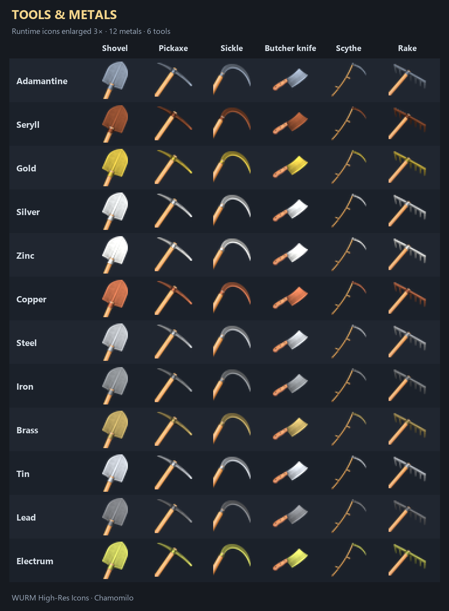
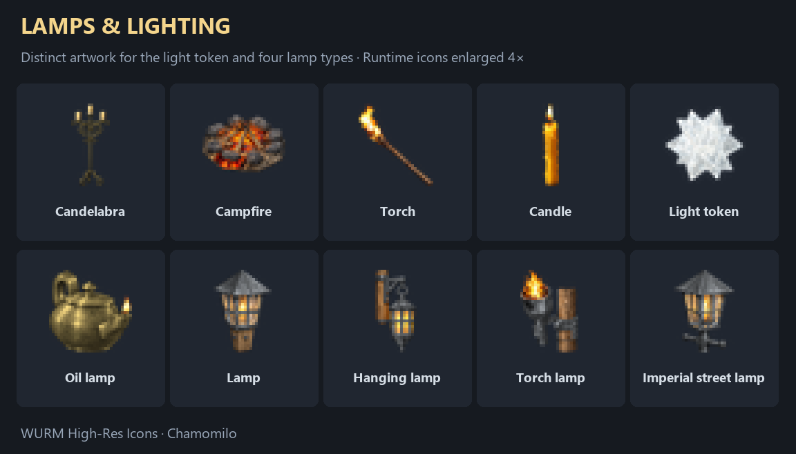
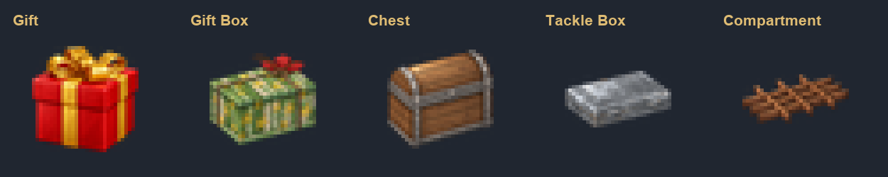

# WURM High-Res Icons


Detailed item icons, material colours and animated rarity effects for the **Wurm Unlimited client**, by **Chamomilo**.

[Download 0.2.0](https://github.com/chamomilo/wurm-high-res-icons/releases/tag/v0.2.0) · [Release notes](CHANGELOG.md) · [Report an issue](https://github.com/chamomilo/wurm-high-res-icons/issues)


## Features

- Detailed 32 × 32 artwork in Inventory, Toolbelt, Equipment and Creation/Build windows.
- Separate images for supported shared-icon items, including gifts, containers, lamps, frying pan and sauce pan.
- Metal and wood colours based on the item's material. Masks preserve wooden handles, glass, candles and other parts.
- Individual colours for drake hides and dragon scales.
- Animated rare, supreme and fantastic glow, with a pulsing blob or rotating star.
- Rainbow shimmer for magic water skins and Santa sacks.
- An in-game Settings editor with hover help and saved preferences.

The resource pack loads at client startup. Item artwork follows the game designs with smoother contours and clearer silhouettes.

## Tools and materials

The palette distinguishes white zinc, slightly greyer silver, light steel, dark iron, yellow gold, reddish copper, warm brass, cool tin, dark lead and yellow-green electrum. Adamantine and seryll use the game's colours. Supported material-specific server items use the same artwork across rarity levels.



These previews show the actual 32 × 32 icons enlarged for comparison.

## Lamps and lighting

Candelabra, campfire, wooden torch, wax candle and light token have redesigned images. Oil lamp, lamp, hanging lamp, torch lamp and imperial street lamp show distinctive lamp heads. The light token and four assembled lamp types each have separate artwork.



## Gifts and containers

Gift and gift box have different images. Chest, tackle box and compartment preserve their individual game designs. Material masks keep the chest's metal fittings and the gift's red-and-gold colours intact.



## Buoy and clay vessels

The buoy has its own lantern-on-barrel image. Its wood mask preserves the lantern and iron hoops. Raw clay vessels are matte grey; fired pottery is warm brown. Rounded rims, bodies and handles remove the sharp corners of the original models.


## Cookware

The pottery flask has a clearly visible side handle. The metal bowl retains its relief and low base. Frying pan and sauce pan use separate shallow and deep profiles in Inventory, recipes and ground Build slots. The cauldron retains its side lugs and feet. Four metal masks apply the tool palette to the cookware.


## Installation

Requires **Wurm Unlimited** with [Ago's Client ModLauncher](https://github.com/ago1024/WurmClientModLauncher/releases).

1. Close the game client.
2. Download [WURM-High-Res-Icons-0.2.0.zip](https://github.com/chamomilo/wurm-high-res-icons/releases/tag/v0.2.0).
3. Extract it into your `WurmLauncher` folder, preserving the `mods` structure.
4. When updating, replace the configuration or merge your custom values into the new file.
5. Start the client through Client ModLauncher.

The ZIP contains exactly four files:

```text
README.txt
mods/wurm-highres.properties
mods/wurm-highres/wurm-highres-0.2.0.jar
mods/wurm-highres/wurm-highres-resources-0.2.0.jar
```

## Settings

Open **Mod updates** after the HUD appears, then select **Settings** on the High Res Icons card. Parameters include hover help. Valid changes are saved automatically and apply during play where supported. Startup-only changes show a restart notice and offer Wurm's normal quit confirmation.

The editor follows the shared language selection. You can also edit `mods/wurm-highres.properties` with the client closed.

| Setting | Default | Purpose |
| --- | --- | --- |
| `replaceIcons` | `true` | Replacement item artwork. |
| `rarityGlow` | `true` | Rare-item glow. |
| `rarityBackground` | `false` | Coloured background behind rare items. |
| `rarityAnimation` | `blob` | Choose `blob` or `star`. |
| `pulseGlow` | `true` | Animate the glow. |
| `magicShimmer` | `true` | Magic water skin and Santa sack shimmer. |
| `glowRadius` | `3` | Glow width in pixels. |
| `glowAlpha` | `0.48` | Glow opacity. |
| `backgroundAlpha` | `0.16` | Rarity background opacity. |
| `rareColor` | `66,153,224` | Rare colour. |
| `supremeColor` | `0,255,255` | Supreme colour. |
| `fantasticColor` | `255,0,255` | Fantastic colour. |

Colours accept RGB values or `#RRGGBB`. The `resourcePack` path must match the installed resource JAR; changing it requires a restart.

## Updates

Version **0.2.0** embeds **Chamomilo updater 1.5.0** and **Chamomilo UI 0.4.11**. The shared registry lists participating mods and their available releases. **DOWNLOAD** opens the release page. Install ZIP updates manually with the client closed.

## Building from source

Use JDK 8, the Gradle wrapper, your Wurm client libraries and the canonical Chamomilo updater checkout:

```sh
./gradlew test publicationZip -PwurmClientLibDir=/path/to/client/libs -PchamomiloUpdaterReference=/path/to/updater
```

The client library directory must contain `client-patched.jar`, `common.jar`, `javassist.jar` and `modlauncher.jar`. The updater build also needs its documented test libraries and JavaFX runtime. The verified release archive is written to `build/publication/`.

## License

GNU GPL 3.0 or later. See [LICENSE](LICENSE). The mod JAR includes the GPL text, the earlier LGPL notice and embedded components' license notices.
