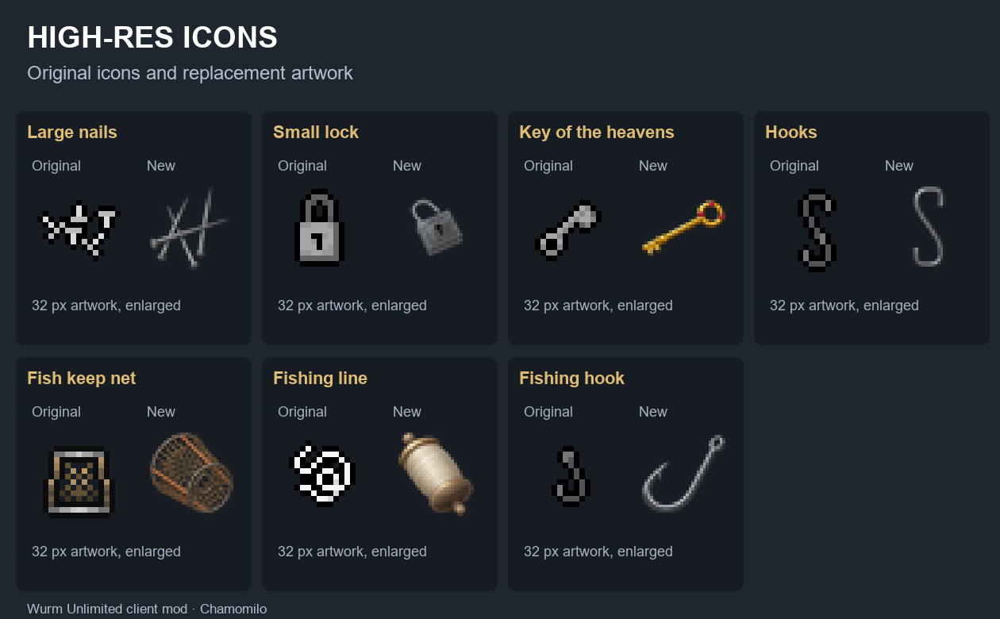
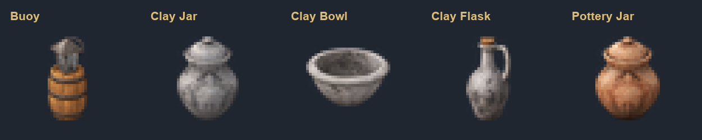
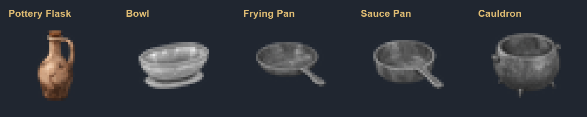
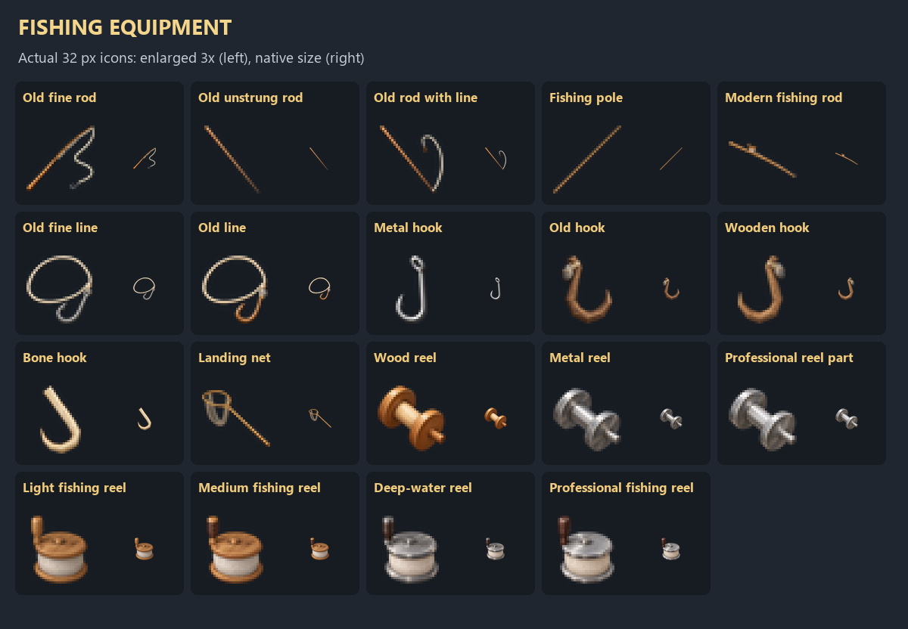
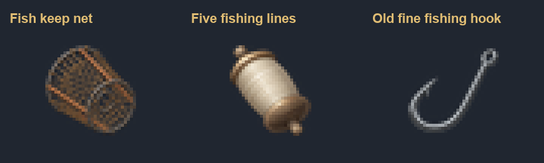
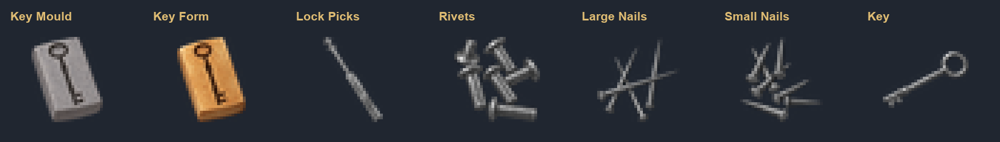
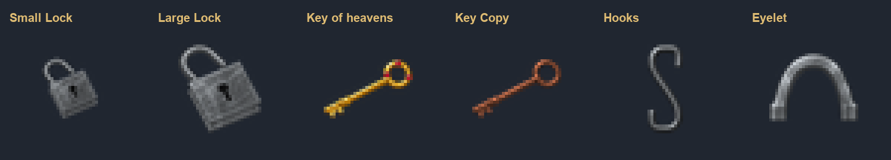
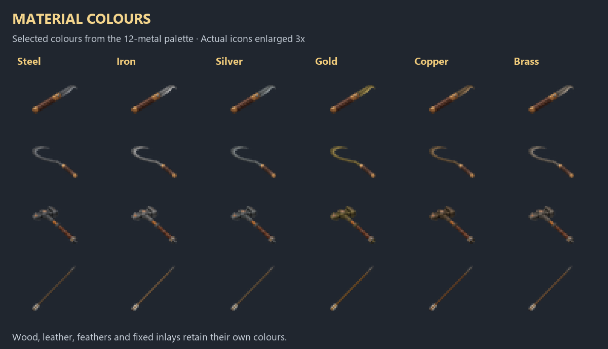
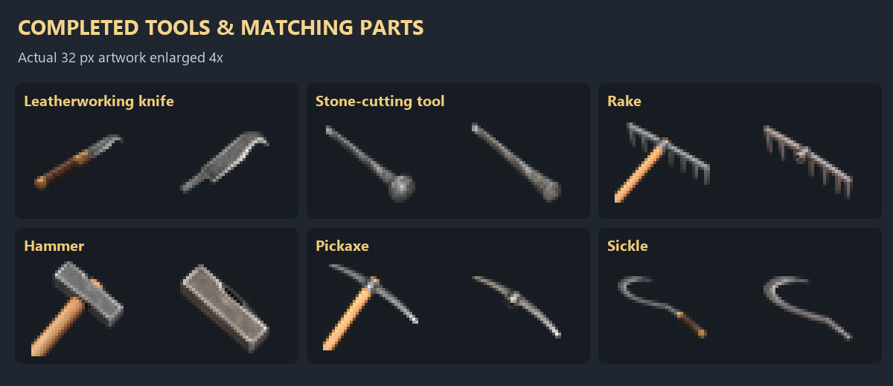
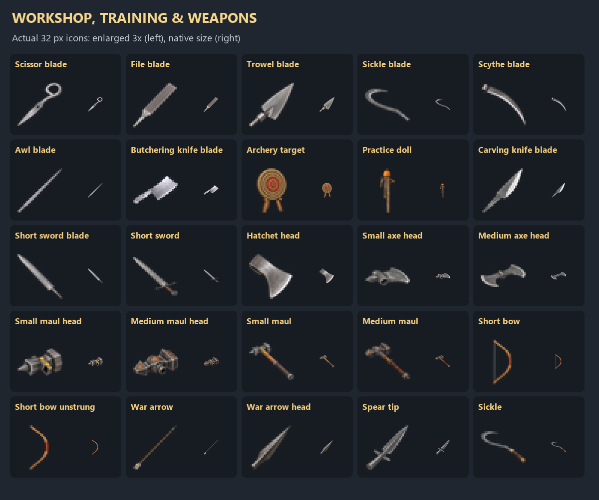

# Icon previews

These images are documentation previews. The game uses the 32 × 32 assets embedded in the resource JAR. Enlarged examples show their runtime pixels.

## Before After

## Buoy Pottery

## Containers

## Cookware

## Fishing Equipment

## Fishing

## Hardware

## Lighting

## Locks Hardware

## Material Colours

## Tools And Parts

## Workshop

